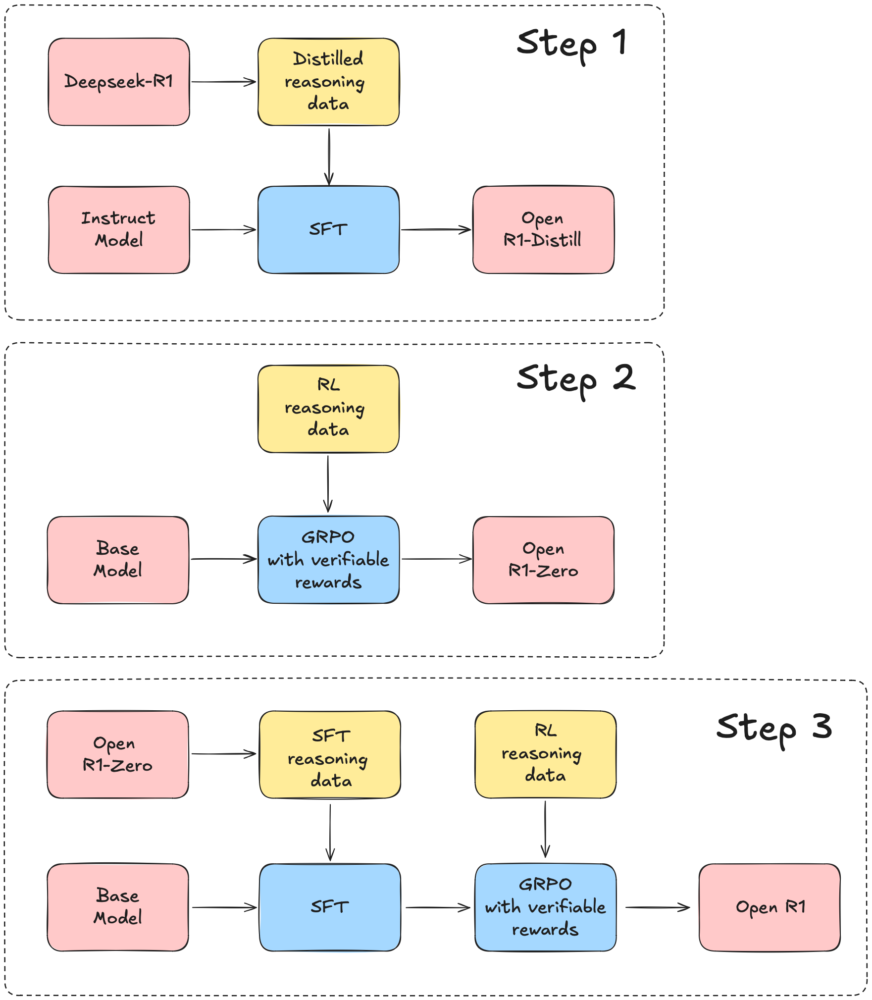

# Loop-R1: Learning Semantic Reasoning for Loop Invariant Synthesis

A fully open reproduction of DeepSeek-R1's pipeline, tailored for formal program reasoning. This repository implements the Loop-R1 framework to systematically enhance the semantic reasoning capabilities of large language models (LLMs) for loop invariant synthesis. 

**Table of Contents** 1. [Overview](https://www.google.com/search?q=%23overview)

2. [Plan of Attack](https://www.google.com/search?q=%23plan-of-attack)

3. [Installation](https://www.google.com/search?q=%23installation)

4. [Training Models](https://www.google.com/search?q=%23training-models)

5. [Reward Functions (Formal Feedback)](https://www.google.com/search?q=%23reward-functions-formal-feedback)

6. [Evaluating Models](https://www.google.com/search?q=%23evaluating-models)

7. [Citation](https://www.google.com/search?q=%23citation)

---

## Overview

Loop invariant generation is a fundamental challenge in formal program reasoning. While recent approaches rely on prompting powerful pretrained LLMs, they largely treat models as static generators and suffer from prolonged guess-and-check cycles.

This project adapts the Open R1 methodology to loop invariants, providing a unified training pipeline that integrates supervised fine-tuning (SFT) and reinforcement learning from formal feedback (RL).

Here is the updated **Plan of Attack** section with the architectural diagram included to clearly illustrate the 3-step Loop-R1 pipeline.

---

### Plan of Attack

We map the core R1 pipeline to the formal verification domain to intrinsically enhance the semantic reasoning of large language models:

* 
**Step 1: Distilled Reasoning Data (SFT):** We synthesized 172,000 high-quality C/C++ loop programs, annotated them with verified invariants, and used strong LLMs to distill step-by-step reasoning traces. We fine-tune base models on a curated dataset of 28,420 `<program, invariant, reasoning>` triples.


* 
**Step 2: RL with Verifiable Rewards (GRPO):** We replace standard RLHF with objective, automated formal feedback. Models are optimized using Satisfiability Modulo Theories (SMT) solvers and Bounded Model Checking (BMC) to ensure semantic correctness during invariant exploration.


* 
**Step 3: Joint Optimization (SFT + RL):** We combine trace-level supervision with outcome-driven exploration. The model is initialized with reasoning-aware SFT and subsequently refined through exploration-driven reinforcement learning, achieving robust generalization and semantic correctness.


<center>

</center>


---

## News 🗞️

* 
**[Dataset Release]** We release our high-quality dataset of 28,420 C/C++ programs, formally verified invariants, and step-by-step reasoning traces.


* 
**[Pipeline Complete]** We have successfully trained small open-source instruction-tuned models (e.g., Qwen3-1.7B-Instruct, Llama-3.2-1B-Instruct) using our SFT+RL pipeline. These compact models rival or surpass larger commercial instruction-tuned LLMs in invariant synthesis.


---

## Installation

To run the code, create a Python virtual environment and install the required machine learning dependencies (vLLM, FlashAttention, etc.) as usual:

```shell
uv venv loop_r1 --python 3.11 && source loop_r1/bin/activate
uv pip install vllm==0.8.5.post1 flash-attn --no-build-isolation
uv pip install -e ".[dev]"

```

**Formal Verification Dependencies:**
You must install the formal verifiers required for the RL reward functions.

* 
**Z3:** Commonly used to check pre-condition satisfaction, invariant preservation, and post-condition satisfaction.


* 
**ESBMC:** Used for bounded model checking by unwinding the loop up to a bound .


```shell
sudo apt-get install z3
# Follow ESBMC official instructions for your system

```

---


## Training Models

We support both SFT and GRPO tailored for formal verification tasks. The following sections provide robust batch-processing scripts that automate port generation, loop through multiple configuration files, and manage distributed training.

### Supervised Fine-Tuning (SFT)

For SFT, we train models using FSDP for memory efficiency. The following `sft_fse_pipeline.sh` script iterates backward through an array of YAML configurations, sets up a random port for distributed launching, and executes `sft_raw.py`:

```bash
#!/bin/bash
export CUDA_HOME="/opt/apps/software/CUDA/12.6.0/"
export PYTHONPATH="./src"
#export NCCL_DEBUG="INFO"

config_files=(
        recipes_paper/reduce_rq4/sft_reduce_full.yaml
)

readarray -t reversed < <(printf '%s\n' "${config_files[@]}" | tac)

for config in "${reversed[@]}"; do
  # Generate a random port
  PORT=$(( ((RANDOM<<15)|RANDOM) % 63001 + 2000 ))
  
  # Extract a base name for the log file
  log_name=$(basename "$config" .yaml)
  
  echo "Running with config: $config"
  echo "Logging to: zero3_sft_${log_name}.log"
  
  accelerate launch --config_file recipes/accelerate_configs/fsdp.yaml \
    --num_processes 4 \
    --main_process_port $PORT \
    src/open_r1/sft_raw.py \
    --config "$config" \
     2>&1 | tee "zero3_sft_${log_name}.log"
  
  echo "Finished running $config"
  echo "----------------------------------------"

  sleep 5 
done

```

### Reinforcement Learning (GRPO)

For GRPO, we launch `accelerate` with DDP instead of FSDP due to the higher GPU memory overhead required for RL. The following `grpo_assess.sh` script demonstrates how to run training using vLLM in colocate mode to optimize generation during RL:

```bash
#!/bin/bash
export CUDA_HOME="/opt/apps/software/CUDA/12.6.0/"
export PYTHONPATH="./src"
export CUDA_VISIBLE_DEVICES=0,1,2,3
export NCCL_DEBUG="INFO"

shuffled_configs=(
        recipes_paper/reduce_rq4/grpo_reduce5k_full.yaml
)

for config in "${shuffled_configs[@]}"; do
    echo "Processing config: $config"
    log_name=$(basename "$config" .yaml)

        sleep 6 

        PORT=$(( ((RANDOM<<15)|RANDOM) % 63001 + 2000 ))
        accelerate launch --config_file recipes/accelerate_configs/ddp.yaml \
                 --num_processes 4 \
                --main_process_port $PORT \
                          src/open_r1/grpo.py \
                --config $config \
                    --vllm_mode "colocate" --vllm_tensor_parallel_size 4 --vllm_gpu_memory_utilization 0.3 \
            --per_device_train_batch_size 8 2>&1 | tee   "grpo_${log_name}.log"

        sleep 50
done

```


---

## Reward Functions (Formal Feedback)

Instead of human preference models or standard code execution, our RL pipeline uses a composite reward function based on formal verification:

 

* 
****: Assigns a reward if the generated invariant satisfies inductiveness checks in an SMT solver (e.g., Z3).


* 
****: Assigns a reward if the invariant passes bounded model checking (e.g., ESBMC), unwinding the loop up to .


* 
****: Ensures semantic consistency, penalizing translation bugs that might occur when converting C-level invariants to SMT formulas.


* 
****: Rewards outputs that clearly structure the invariant in a parseable format.


---

## Evaluating Models

We evaluate semantic correctness and generalization on two distinct benchmarks:

* 
**Clause2Inv-Bench**: Contains 316 linear and 50 non-linear loop invariant synthesis tasks.


* 
**InvBench**: Contains 226 structurally complex verification tasks with longer programs (averaging 62 lines of code) and multiple loops/arrays.


### Single-Shot Inference

We evaluate single-pass invariant inference using the unbiased `pass@k` metric. For stochastic decoding, we sample  candidates at a temperature of  to compute `pass@10`.

```shell

bash local_vlm_all_large.sh 


```

### Iterative-Refinement Inference

We also evaluate models using counterexample-guided refinement via the LaM4Inv framework. The metrics used are Success Rate (SR), number of SMT queries (#Q), and Time.

---

## Citation

If you find this project useful in your own work, please consider citing as follows:

```bibtex
@article{loopr1_2018,
  title={Loop-R1: Learning Semantic Reasoning for Loop Invariant Synthesis in Large Language Models},
  author={Anonymous Author(s)},
  journal={J. ACM},
  volume={37},
  number={4},
  pages={Article 111},
  year={2018},
  publisher={ACM}
}

```


---

## Acknowledgements

This project is built upon and inspired by the excellent work of the Hugging Face team on [Open R1](https://github.com/huggingface/open-r1). We extend our gratitude to them for providing a fully open reproduction of the DeepSeek-R1 pipeline, which served as the foundational framework for our adaptations in formal program reasoning and loop invariant synthesis.

If you build upon this pipeline, please consider acknowledging their work:

```bibtex
@misc{openr1,
    title = {Open R1: A fully open reproduction of DeepSeek-R1},
    url = {https://github.com/huggingface/open-r1},
    author = {{Hugging Face}},
    month = {January},
    year = {2025}
}

```


